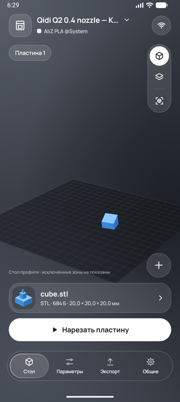
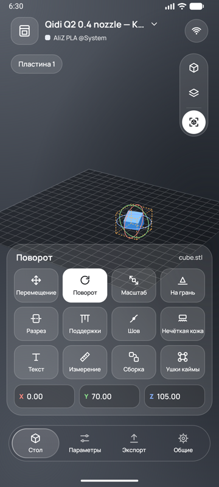
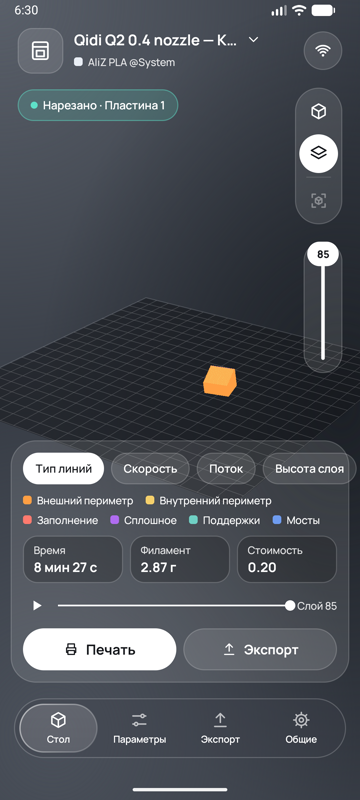
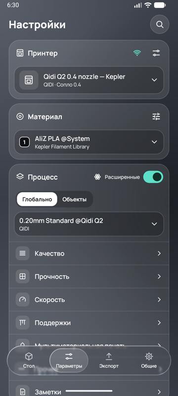

<div align="center">


# Kepler Slicer

**English** | [Русский](README.ru.md)

[](#requirements)
[](https://github.com/OrcaSlicer/OrcaSlicer)
[](LICENSE-ORCASLICER.txt)
[](https://github.com/nitronov/Kepler-Slicer/actions/workflows/ci.yml)

A 3D-printing slicer for Android phones and tablets, built on the OrcaSlicer engine.<br>
Prepare a model, slice it on the device and send it to your printer — no computer needed.

</div>

<table>
<tr>
<td>
<strong>⚠️ Early version.</strong> Kepler Slicer is under active development and is not an official OrcaSlicer app.
Check the G-code preview before printing, and do not leave a printer unattended with a print you have not verified.
</td>
</tr>
</table>

<div align="center">

| Workspace | Tools | Layer preview | Settings |
|:---:|:---:|:---:|:---:|
|  |  |  |  |

</div>

# Main features

- **The real OrcaSlicer engine on the phone**<br>
  Slicing runs on the device through the native OrcaSlicer engine (arm64), with the same printer, process and filament profiles as the desktop version.
- **Models and projects**<br>
  STL, OBJ, 3MF and STEP. 3MF projects keep their plates, objects, colours and settings; several plates and multi-material projects are supported. Models can also be opened from a Printables link or generated as simple shapes.
- **Editing tools**<br>
  Move with X/Y/Z arrows, rotate with X/Y/Z rings, scale, lay on face, sink below the plate, cut, add text, assemble, measure, and brushes for supports, seams, colour and fuzzy skin.
- **Full printer catalogue**<br>
  Every printer of the desktop version (450+ models from Bambu Lab, Prusa, Creality, Qidi, Elegoo, Anycubic, Voron and more), grouped by maker; filaments grouped by brand.
- **All slicer settings**<br>
  Quality, strength, speed, supports, multi-material and other settings with search, user presets and per-object overrides.
- **Layer preview**<br>
  3D preview of the toolpaths by line type, speed, flow and layer height, with print time, filament and cost.
- **Printing over the network**<br>
  Upload, start and control prints on Bambu Lab (LAN and cloud), OctoPrint, Klipper/Moonraker, PrusaLink, Duet, Repetier, Creality, Elegoo and more; Bambu Lab printers are found on Wi-Fi automatically. See [Network support](NETWORK_SUPPORT.md).
- **Glass interface**<br>
  A clean dark interface with English and Russian translations.

# Download

Builds are published on the [Releases](https://github.com/nitronov/Kepler-Slicer/releases) page.
Download the `.apk`, open it on the phone and allow installation from this source.

## Requirements

- Android 13 or newer, 64-bit ARM device (arm64-v8a)
- About 500 MB of free storage (the engine unpacks its printer profiles on first start)

# How to build

Prerequisites: Android Studio (or JDK 17+), Android SDK 36. The native engine is prebuilt in `engine/jniLibs`;
rebuilding it needs the Android NDK r30 and the OrcaSlicer dependencies (see [engine/README.md](engine/README.md)).

```bash
./gradlew assembleDebug        # app/build/outputs/apk/debug/app-debug.apk
./gradlew :core:test           # JUnit tests of the core module
pwsh tools/run_host_tests.ps1 -JsonJar <path to org.json jar>   # protocol and settings test suites
```

## Project structure

| Module | Contents |
|---|---|
| `app` | Android screens, glass UI, 3D view and device storage |
| `core` | Plain Java: printer protocols, network transport, model geometry, profile and project parsing |
| `engine` | JNI bridge and the native OrcaSlicer engine (`libkepler_slicer_experimental.so`) |

More in [docs/architecture/MODULES-AND-KOTLIN.md](docs/architecture/MODULES-AND-KOTLIN.md).

# License

Kepler Slicer is based on [OrcaSlicer](https://github.com/OrcaSlicer/OrcaSlicer) and is licensed under the
**GNU Affero General Public License, version 3** — see [LICENSE-ORCASLICER.txt](LICENSE-ORCASLICER.txt).
OrcaSlicer is based on Bambu Studio by Bambu Lab, which is based on PrusaSlicer by Prusa Research, which is based on
Slic3r by Alessandro Ranellucci and the RepRap community.

The printer profiles, images and translated setting names come from OrcaSlicer at commit
[`6d2869c`](https://github.com/OrcaSlicer/OrcaSlicer/tree/6d2869c430284714f0a22570c38d3b359965a802).
Fonts: Manrope ([OFL](docs/Manrope-OFL.txt)); icons: Material Symbols ([Apache 2.0](docs/Material-Symbols-LICENSE.txt)).

Kepler Slicer is not affiliated with OrcaSlicer, Bambu Lab or any printer maker. Product names are trademarks of
their owners.
