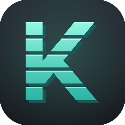
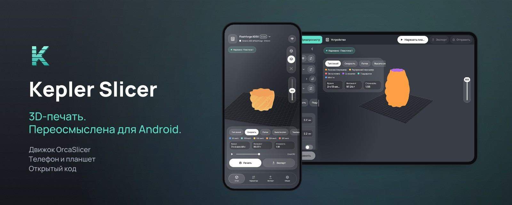
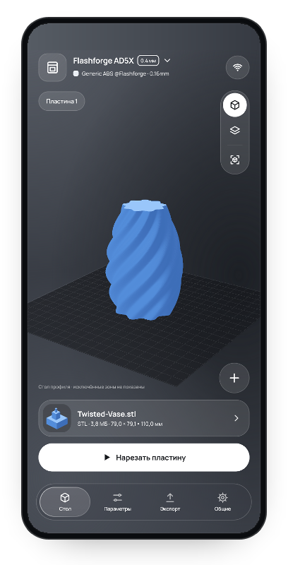
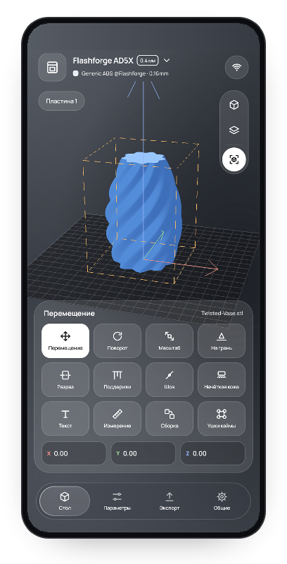
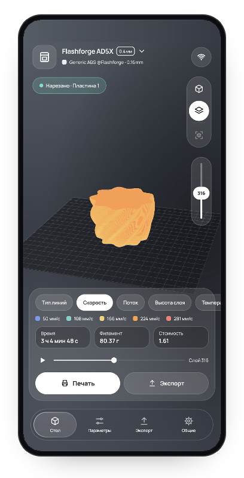
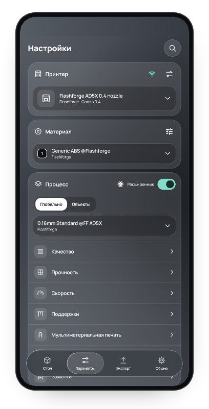
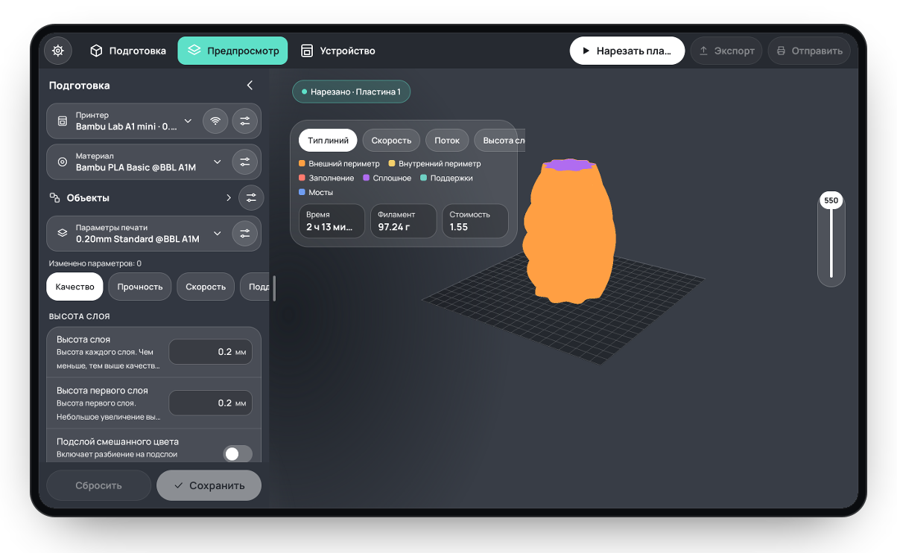

<div align="center">



# Kepler Slicer

[English](README.md) | **Русский**

[](#требования)
[](https://github.com/OrcaSlicer/OrcaSlicer)
[](LICENSE-ORCASLICER.txt)
[](https://github.com/fabricodelabs/Kepler-Slicer/actions/workflows/ci.yml)

Слайсер для 3D-печати на Android-телефонах и планшетах на движке OrcaSlicer.<br>
Подготовьте модель, нарежьте её прямо на устройстве и отправьте на принтер — без компьютера.

</div>

<table>
<tr>
<td>
<strong>⚠️ Ранняя версия.</strong> Kepler Slicer активно разрабатывается и не является официальным приложением OrcaSlicer.
Проверяйте просмотр G-code перед печатью и не оставляйте принтер без присмотра с непроверенной печатью.
</td>
</tr>
</table>

<div align="center">



| Стол | Инструменты | Просмотр слоёв | Параметры |
|:---:|:---:|:---:|:---:|
|  |  |  |  |

**Режим планшета** — компоновка настольного OrcaSlicer



</div>

# Основные возможности

- **Настоящий движок OrcaSlicer в телефоне**<br>
  Нарезка выполняется на устройстве нативным движком OrcaSlicer (arm64) с теми же профилями принтеров, процессов и пластиков, что и в настольной версии.
- **Модели и проекты**<br>
  STL, OBJ, 3MF и STEP. Проекты 3MF сохраняют пластины, объекты, цвета и настройки; поддерживаются несколько пластин и многоматериальные проекты. Модель можно открыть по ссылке Printables или создать простую фигуру.
- **Инструменты редактирования**<br>
  Перемещение стрелками X/Y/Z, поворот кольцами X/Y/Z, масштаб, «на грань», утопление ниже стола, разрез, текст, сборка, измерение и кисти поддержек, шва, цвета и нечёткой кожи.
- **Полный каталог принтеров**<br>
  Все принтеры настольной версии (450+ моделей Bambu Lab, Prusa, Creality, Qidi, Elegoo, Anycubic, Voron и других) с группировкой по производителям; пластики сгруппированы по брендам.
- **Все настройки слайсера**<br>
  Качество, прочность, скорость, поддержки, многоматериальная печать и прочие параметры с поиском, пользовательскими профилями и настройками для отдельных объектов.
- **Нарезка прямо на столе**<br>
  Без отдельного окна нарезки: прогресс показывается над столом, а по готовности сам открывается просмотр слоёв.
- **Просмотр слоёв**<br>
  3D-просмотр траекторий по типу линий, скорости, потоку и высоте слоя со временем печати, расходом пластика и стоимостью.
- **Режим планшета**<br>
  На планшете — компоновка настольного OrcaSlicer: вкладки Подготовка / Предпросмотр / Устройство, боковая панель с редактором настроек, инструменты над столом; настройки, профили и экспорт открываются окнами (Общие → Основные → Режим отображения).
- **Печать по сети**<br>
  Отправка, запуск и управление печатью на Bambu Lab (LAN и облако), OctoPrint, Klipper/Moonraker, PrusaLink, Duet, Repetier, Creality, Elegoo и других; принтеры Bambu Lab находятся в Wi-Fi автоматически. Подробнее — в [Network support](NETWORK_SUPPORT.md) (на английском).
- **Стеклянный интерфейс**<br>
  Аккуратный тёмный интерфейс на русском и английском языках.

# Скачать

Сборки публикуются на странице [Releases](https://github.com/fabricodelabs/Kepler-Slicer/releases).
Скачайте `.apk`, откройте его на телефоне и разрешите установку из этого источника.

## Требования

- Android 13 или новее, 64-битный ARM (arm64-v8a)
- Около 500 МБ свободного места (при первом запуске движок распаковывает профили принтеров)

# Сборка из исходников

Понадобятся Android Studio (или JDK 17+) и Android SDK 36. Нативный движок уже собран и лежит в `engine/jniLibs`;
для его пересборки нужны Android NDK r30 и зависимости OrcaSlicer (см. [engine/README.md](engine/README.md)).

```bash
./gradlew assembleDebug        # app/build/outputs/apk/debug/app-debug.apk
./gradlew :core:test           # JUnit-тесты модуля core
pwsh tools/run_host_tests.ps1 -JsonJar <путь к org.json jar>   # тесты протоколов и настроек
```

## Структура проекта

| Модуль | Содержимое |
|---|---|
| `app` | Экраны Android, стеклянный интерфейс, 3D-вид и хранение данных на устройстве |
| `core` | Чистая Java: протоколы принтеров, сетевой транспорт, геометрия модели, разбор профилей и проектов |
| `engine` | JNI-мост и нативный движок OrcaSlicer (`libkepler_slicer_experimental.so`) |

Подробнее — в [docs/architecture/MODULES-AND-KOTLIN.md](docs/architecture/MODULES-AND-KOTLIN.md) (на английском).

# Лицензия

Kepler Slicer основан на [OrcaSlicer](https://github.com/OrcaSlicer/OrcaSlicer) и распространяется по лицензии
**GNU Affero General Public License версии 3** — см. [LICENSE-ORCASLICER.txt](LICENSE-ORCASLICER.txt).
OrcaSlicer основан на Bambu Studio от Bambu Lab, Bambu Studio — на PrusaSlicer от Prusa Research, а PrusaSlicer — на
Slic3r Алессандро Ранеллуччи и сообщества RepRap.

Профили принтеров, изображения и переводы названий параметров взяты из OrcaSlicer на коммите
[`6d2869c`](https://github.com/OrcaSlicer/OrcaSlicer/tree/6d2869c430284714f0a22570c38d3b359965a802).
Шрифт: Manrope ([OFL](docs/Manrope-OFL.txt)); иконки: Material Symbols ([Apache 2.0](docs/Material-Symbols-LICENSE.txt)).

Kepler Slicer не связан с OrcaSlicer, Bambu Lab и производителями принтеров. Названия продуктов являются товарными
знаками их владельцев.
