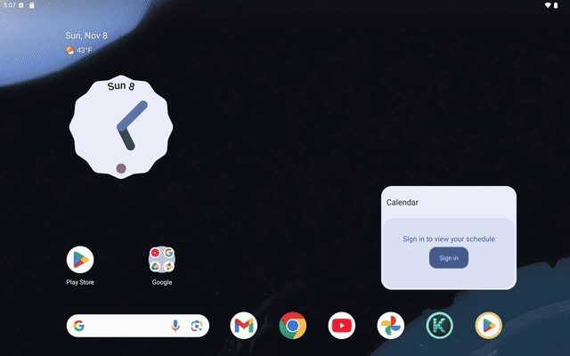

# Kepler Slicer — brand kit



## The mark: "Sliced K"
A geometric **K** made of three solid shapes (stem, upper arm, lower leg) and cut into **five horizontal print
layers**. Each layer casts a short extrusion to the lower right and carries a light top edge, so the letter reads as a
part that was printed layer by layer — the core idea of a slicer — without drawing a printer or a nozzle.
Colours come from the app: mint `#5EE0C8` (Glass UI accent) as a gradient from `#92F7E2` to `#2DB3A5`, extrusion
`#145C58`, on graphite `#2B3038 → #14171C`.

| | |
|---|---|
|  |  |

### Concepts considered
| Concept | File | Recognition | Aesthetic | Scales to 24 px | Fits the app |
|---|---|---|---|---|---|
| **A — Sliced K** (chosen) | [concept-a-sliced-k.svg](logo/concepts/concept-a-sliced-k.svg) | strong: letter + layers | precise, technical, calm | yes (layers merge into a solid K) | mint + graphite, Glass UI |
| B — Orbit K | [concept-b-orbit-k.svg](logo/concepts/concept-b-orbit-k.svg) | good (Kepler → orbits) | elegant but generic "space" | ellipse thins out | says astronomy, not 3D printing |
| C — Iso cube | [concept-c-iso-cube.svg](logo/concepts/concept-c-iso-cube.svg) | weak: K is small inside the cube | 3D, but busy | K disappears below 48 px | close to many CAD icons |

A won: it is the only one that tells "slicing" at a glance, stays a clear K at launcher sizes
([small-sizes.png](app-icon/previews/small-sizes.png)) and is built from the same few shapes everywhere.

## Files
```
logo/primary.svg                  mark, full colour (transparent)
logo/monochrome.svg               mark, one colour, layers kept
logo/mark-compact*.svg            solid K without layers, for 16–24 px (favicons, tiny UI)
logo/dark.svg / light.svg         horizontal lockups on graphite / white (text as outlines, Manrope)
logo/lockup-on-dark|light.svg     the same lockups without background
logo/lockup-stacked.svg           mark over name (splash composition)
logo/previews/                    hero-1200x630.png (store/social), mark PNGs
app-icon/adaptive/                foreground.svg, background.svg (108 dp canvas)
app-icon/monochrome/              themed-icon layer
app-icon/legacy/                  48–192 px square and round PNGs
app-icon/play-store-512.png       Play Store icon (full bleed, the store masks it)
app-icon/previews/                launcher masks, small sizes, real launcher and themed-icon screenshots
splash/animation-source/          system splash blueprint and the final frame (SVG)
splash/previews/                  storyboard.png and the five stage frames from a device recording
splash/recordings/                cold-start-tablet.mp4 (raw), cold-start-light-system-theme.mp4, splash-demo.mp4/.gif
```
Android resources (generated): `app/src/main/res/drawable/ic_launcher_{foreground,background,monochrome}.xml`,
`mipmap-anydpi/ic_launcher{,_round}.xml` (adaptive icon with monochrome layer), `mipmap-*dpi/ic_launcher{,_round}.png`
(legacy), `drawable/splash_blueprint.xml` (system splash icon).

## Launch sequence
| Phase | Where | What |
|---|---|---|
| System splash (Android 12+) | `styles.xml` → `windowSplashScreenBackground #1C1F25`, `windowSplashScreenAnimatedIcon @drawable/splash_blueprint` | graphite screen with the K as a thin mint blueprint while the process starts; no white frame (the manifest theme is dark on every API level) |
| Routing | `LaunchActivity` | draws nothing, starts the workspace; marks the first launcher start of the process |
| Brand animation | `BrandSplash` (Canvas view over the workspace's decor) | continues from the blueprint at the same place and size, then dissolves into the already built workspace |

`BrandSplash` timeline (ms, `TOTAL = 1150`):
1. 0–260 guide lines open from the blueprint, which brightens.
2. 110–640 five layers are laid from the bottom up (70 ms apart, 250 ms each, ease-out), each with a nozzle pass.
3. 560–860 a light sweep crosses the faces; a soft mint glow comes up; the blueprint fades.
4. 600–900 the mark rises, "Kepler Slicer" fades in and moves up 10 dp (Manrope ExtraBold + Medium).
5. 880–1150 everything scales to 94 % and fades; the background fades last, revealing the workspace.

Rules: only on a **cold start from the launcher** (`LaunchActivity.coldStart` + `ACTION_MAIN`), never on warm/hot
starts, returns from the background, recreation or file opens; skipped when system animations are off
(`ValueAnimator.areAnimatorsEnabled()`) or when Preferences → General → "Show splash screen" is off; a tap finishes it.
Paths, paints and shaders are built once in `onSizeChanged`; frames only draw. The view removes itself at the end.

## Changing things
- **Shape, layers, colours**: `core/.../BrandGeometry.java` (shapes in a 100×100 grid, `LAYERS`, `GAP`, `DEPTH`, colours).
- **Icon size in the adaptive canvas, splash scale, line style**: `tools/branding/BrandKit.java` (`ICON_S`, `SPLASH_SCALE`,
  `SPLASH_LINE*`) — keep `BrandSplash.SCALE_DP/LINE_DP/LINE_ALPHA` and `BACKGROUND` equal to them and to `styles.xml`.
- **Timing**: constants at the top of `app/.../BrandSplash.java`.
- Regenerate everything: `pwsh tools/branding/build.ps1` (JDK 17+, Python with `fonttools`), then build the app.
  `BrandGeometryTest` checks the layers, the centring used by the splash and the adaptive safe zone.

## Verified (Pixel Tablet emulator, Android 16)
Cold start (raw recording in `splash/recordings`), hot start and return from home (no animation), system animations
off (no animation), light and dark system theme (same graphite splash, no white frame), launcher icon and themed icon
(`app-icon/previews/launcher-*-real.png`), Preferences and settings screens after the manifest theme change.
Not verified: phones, real devices with 90/120 Hz displays, orientation change during the animation (the tablet
interface is locked to landscape and the phone interface to portrait), low-memory process death mid-animation.

Fonts: Manrope (SIL OFL 1.1, `docs/Manrope-OFL.txt`). All artwork is original.
