# Tablet workspace — UI/UX audit (2026-11-07)

Branch `fix/tablet-ui-ux-audit`. Emulator: Pixel API 37, set to 1600×2560 @ 320 dpi (10" tablet) and the stock
1080×2400 phone. Checked by screenshots, UI Automator dumps, `dumpsys gfxinfo/meminfo` and logcat after every fix.

## Architecture (as found)

| Question | Answer |
|---|---|
| Mode choice | `InterfaceMode` reads `interface_mode` from `app_preferences`; set in Preferences → Interface |
| Layout init | `MainActivity.render()` → `workspace()`; with `tabletMode` it adds the top bar, `TabletSidebar`, canvas toolbar |
| Panel | `TabletSidebar`: strip (collapsed), panel with fixed Prepare column or scrolling sections, resize handle |
| States | expanded / collapsed / hidden, saved with width and section (`core/TabletLayout`, JUnit) |
| Sections | Top tabs and strip call `openTabletSection`; tools/preview reuse the mobile workspace modes |
| 3D | Same `StlView`; the sidebar changes the viewport's left margin (surface resized, not recreated) |
| Project state | Model, selection, plate and camera live in shared workspace state and storage; the layout is rebuilt on every return to the workspace |
| Orientation / resize | No `configChanges`: the activity is recreated; orientation is requested per mode |
| Input | Touch, mouse wheel (existing), Ctrl shortcuts; no context menu |

## Problems found

| # | Priority | Problem | Cause | Fix | Status |
|---|---|---|---|---|---|
| 1 | P0 | Unsaved edits in the embedded print-settings editor were lost on returning to the workspace (from any screen) or on recreation | `render()` rebuilt the panel with a new `ProcessSettingsPanel` and dropped the old one | Draft carried into the new editor and saved in `onSaveInstanceState`; editor disposed in `onDestroy` | Fixed, verified (0.16 kept, "Settings changed: 1") |
| 2 | P0 | Crash when choosing a display mode: `IllegalArgumentException … not attached to window manager` (seen in logcat) | The screen rotates and the activity is recreated while the choice sheet slides out; `dismiss()` ran on a removed window | `SheetDialog` dismisses at once when its activity is finishing and skips a window that is already gone | Fixed, verified (3 mode switches in a row, no crash) |
| 3 | P1 | Tablet mode stayed portrait on a large screen | Android 16 ignores orientation requests on large displays (`ignoreOrientationRequest=true`), a platform policy | Request kept; manifest opt-out property for API 36 added; layout made to work in portrait as well | Platform limit, documented |
| 4 | P1 | Hidden panel always came back expanded; no way to hide from the collapsed strip | Restore was hard-wired to EXPANDED | `TabletSidebar.restore()` returns to the state before hiding; Hide button in the strip | Fixed, verified |
| 5 | P2 | Tool bar above the plate ran past the right edge | Centred wrap-content child with unequal margins in a `FrameLayout` | Full-width scroller with margins, bar centred inside | Fixed, verified |
| 6 | P2 | No top tab highlighted while Tools are open | Tools have no tab | Tools count as Prepare (as in OrcaSlicer) | Fixed, verified |
| 7 | P3 | "Settings changed:1" without a space | Translation string | Fixed in `kepler_messages.json` | Fixed |

| Draft kept after leaving the workspace | Tool bar before → after |
|:---:|:---:|
| 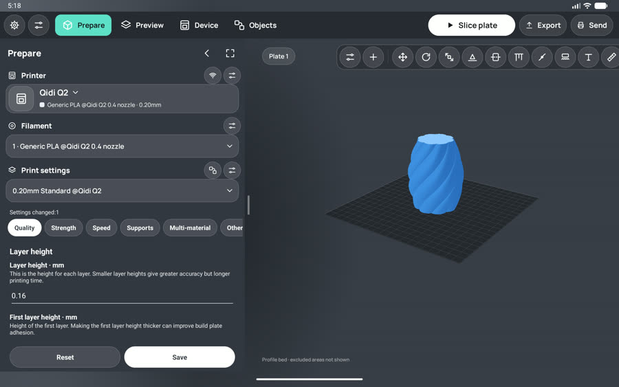 | 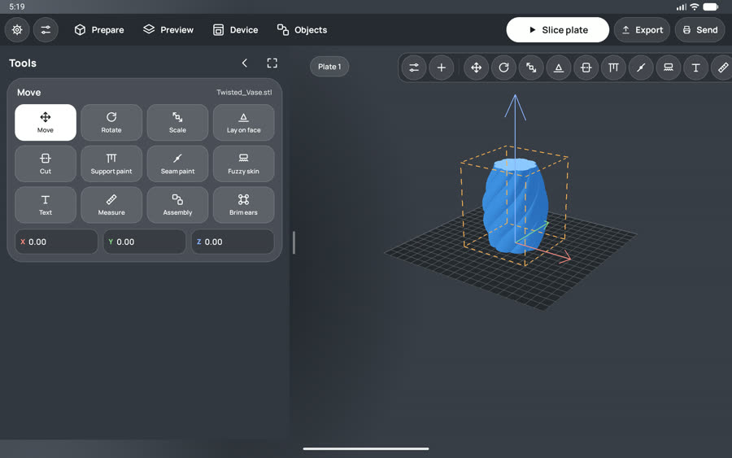 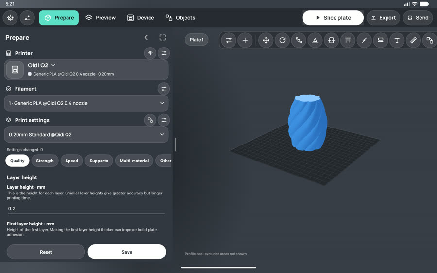 |

| Hidden | Restored (collapsed, as before hiding) | Tools → Prepare tab |
|:---:|:---:|:---:|
| 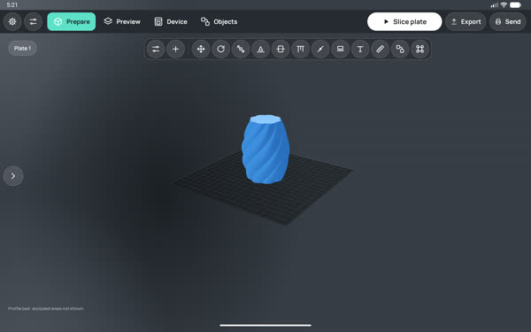 | 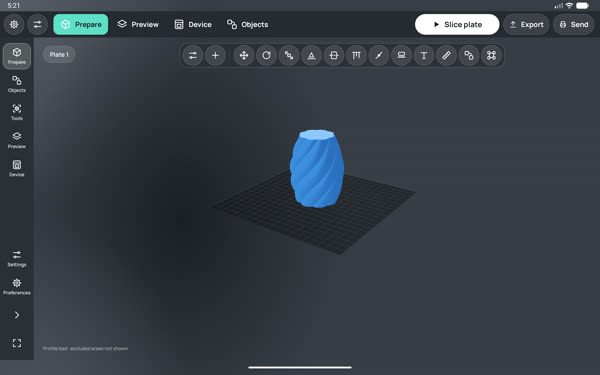 | 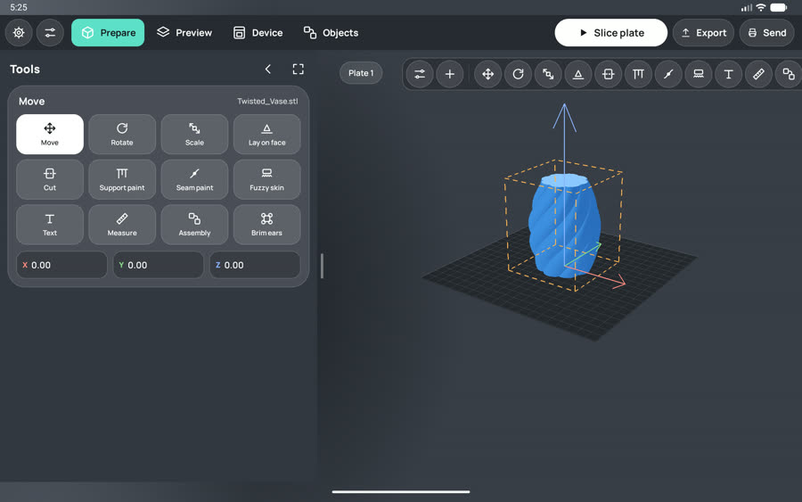 |

## 3D editor checks

| Check | Result |
|---|---|
| Drag the X arrow with the expanded panel (viewport offset 506 dp) | Model moved by X 72.04 mm under the finger |
| Collapse the panel, drag the Y arrow (viewport resized) | Y 68.00 mm, gizmo stays on the model |
| Camera after expand / collapse / hide | Kept (same view in all screenshots) |
| Model and selection after state changes | Kept; Move tool stays active |
| Numeric X/Y/Z input | Works (values typed back to 0) |
| Rapid taps on the tool bar and 9× Ctrl+B, Ctrl+1…5 | No crash, no ANR, state saved correctly |

| Move after offset | Move after collapse |
|:---:|:---:|
| 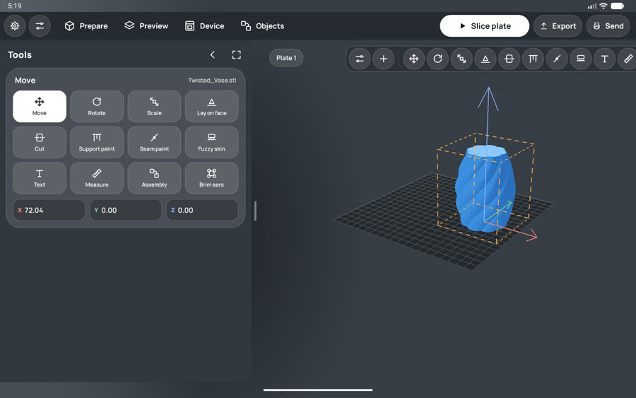 | 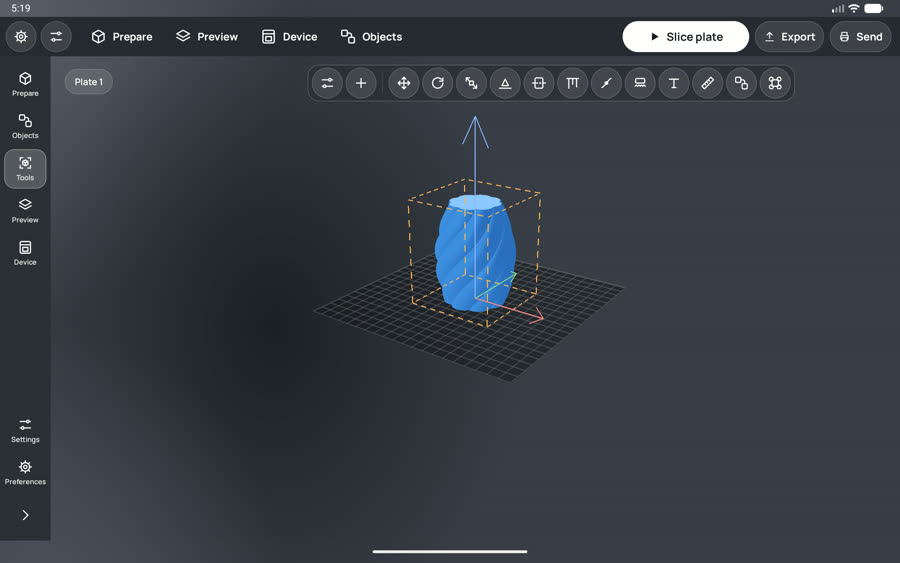 |

## Window sizes

| Configuration | Result |
|---|---|
| 10" tablet landscape | OK (all sections, three states) |
| 10" tablet portrait (platform ignores the lock) | Layout works; see the forced-portrait shot below |
| Phone, tablet mode, landscape | Panel floats over the scene, Prepare scrolls as a whole |
| Phone, mobile mode | Portrait only; mobile layout unchanged |

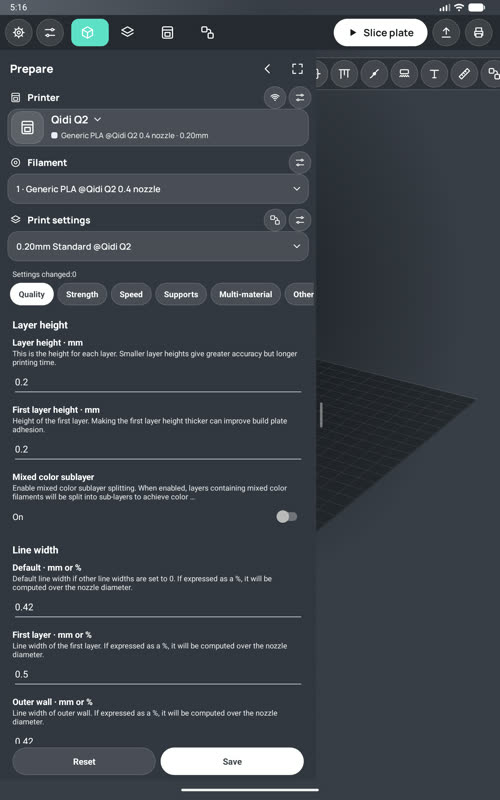 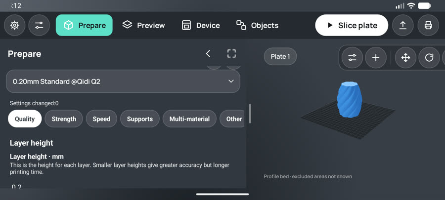

## Performance (emulator, software-rendered GPU: relative numbers only)

- 10 panel toggles: 85 frames, 22% janky, 90th percentile 34 ms. The cost is the GL surface resize and the
  re-measure of the settings editor when the panel expands.
- Memory after the tests: 443 MB PSS, 1 activity, 1 view root (no leaked activities).
- 0 crashes and 0 ANRs from the app during this audit (`logcat -b crash`, `am_anr`).

## Tests and build

- `./gradlew assembleDebug :core:test` — OK. `tools/run_host_tests.ps1` — all 17 suites passed.
- No instrumentation or screenshot-regression suite: the Maestro and adb MCP servers did not connect; checks were done
  with adb, UI Automator dumps and screenshots, which are stored in `docs/tablet-audit/` as references.

## Remaining and not checked

- Android 16+ large screens may keep the app in portrait regardless of the lock (platform policy).
- Panel resize updates the 3D area on release, not while dragging.
- Collapsed state hides the numeric X/Y/Z fields; they come back when the panel is expanded.
- Not checked: 7–8" and 12–14" tablets, foldables, split screen, freeform/desktop windows, stylus, mouse right-click
  (no context menu exists), large system font in tablet mode, a real printer.
- Settings, profile pickers, slicing and export still open as separate screens.

## Changed files

`MainActivity.java` (draft carry-over, restore, tool bar layout, tab highlight), `TabletSidebar.java` (restore,
Hide in the strip), `glass/SheetDialog.java` (safe dismiss), `AndroidManifest.xml` (API 36 opt-out),
`assets/kepler_messages.json` (string), `docs/TABLET_UI_UX_AUDIT.md`, `docs/tablet-audit/*`.

## Round 2: unified design and plate tools (2026-11-07)

| Owner remark | Change |
|---|---|
| Elements stuck together in the panel | Blocks of the Prepare column: 16–20 dp around headers, 40 dp header buttons 8 dp apart, 52 dp selectors, 12 dp between cards |
| Design must match the mobile interface; input fields differ | The embedded settings editor now uses the mobile Glass UI: glass chips, grouped glass cards, label left and the value in the 40 dp field pill with its unit (as in the mobile settings rows), glass switches, mobile buttons |
| Plate tools beside the plate, as in OrcaSlicer | Column at the right of the 3D area: delete plate, put models on the plate, arrange, lock plate, plate settings, move plate to the front; object tools stay in the bar above the plate |

- Engine: `editModel` op 5 puts every object on the plate (`ensure_on_bed`), op 6 arranges with OrcaSlicer
  `arrange_objects` on the printer's printable area, 6 mm apart. No JNI signature change; `build-native.ps1` verified
  the exports. Checked: Arrange on the vase ran without errors and rewrote the model as 3MF.
- Lock: per plate (model file + plate index); tools and plate edits refuse with a message while locked.
- Plate settings: name (stored on the device, shown in the plate chip), print sequence, spiral vase through the same
  validated overrides as the editor. Bed type and the first/other-layer filament order are not exposed by the engine's
  process metadata, so they are not in the sheet yet.
- Delete plate and Move to the front are disabled with one plate (as in OrcaSlicer). For multi-plate projects the
  engine now does them on the whole project (`kepler::edit_project_plates`, `editModel` ops 7 and 8): the plate list
  is reordered or shortened, every kept instance moves with its plate to the new place of the desktop plate grid
  (`plate_grid_origin`, the `PartPlateList` formula), and the project is written back with each plate's name, lock and
  own settings. Deleting asks for confirmation; the neighbouring plate stays open.
- Fixed while checking: glass cards drew past scroll bounds (rows under the Reset/Save buttons, tool bar past the
  edge); scrollers now clip to their outline.

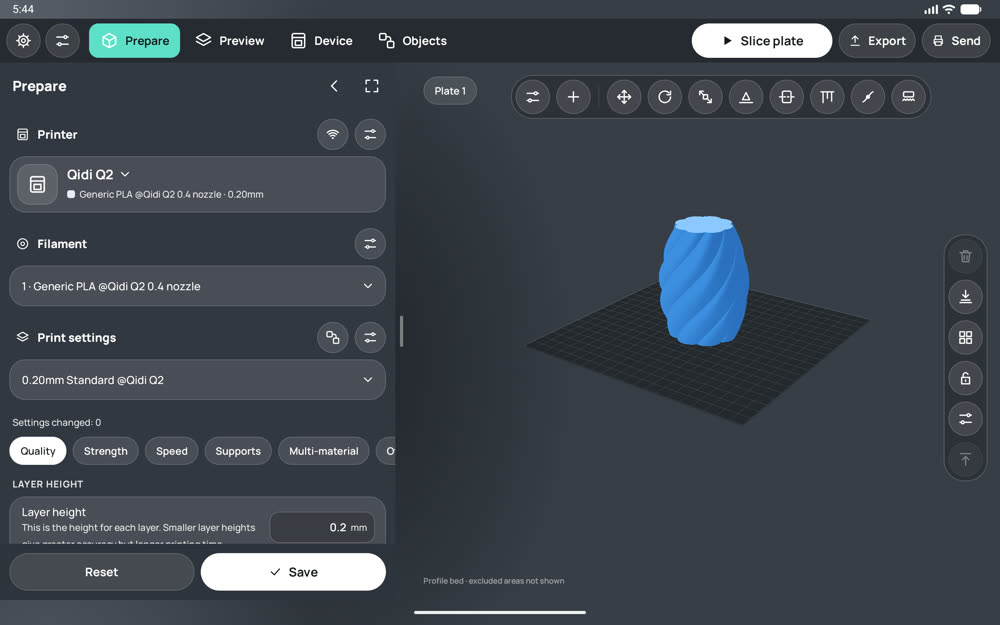

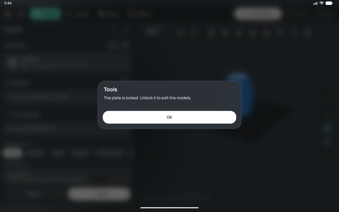 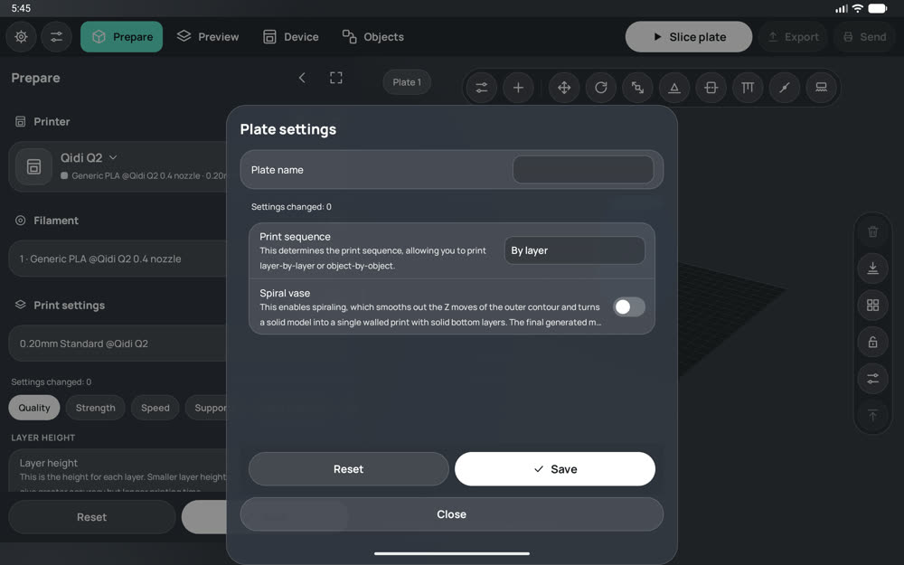

### Multi-plate actions (verified on the Pixel_Tablet emulator, Android 16, 2560×1600)

Fixture `tools/tests/fixtures/ThreePlates.3mf` (OrcaSlicer badge split into plates "Logo", "Vertical", "Horizontal").

| Step | Result |
|---|---|
| Open plate 2 ("Vertical"), **Move plate to the front** | Plates became Vertical, Logo, Horizontal; plate 1 opened with its model on the bed; the button is disabled on plate 1 |
| **Delete plate** on plate 1 (confirmation shown) | Two plates left (Logo, Horizontal); Logo moved onto the bed; plate names kept |
| Crashes / ANR during the run | 0 |

All plate tools exist only in the tablet workspace; the plate lock is ignored in the mobile interface.

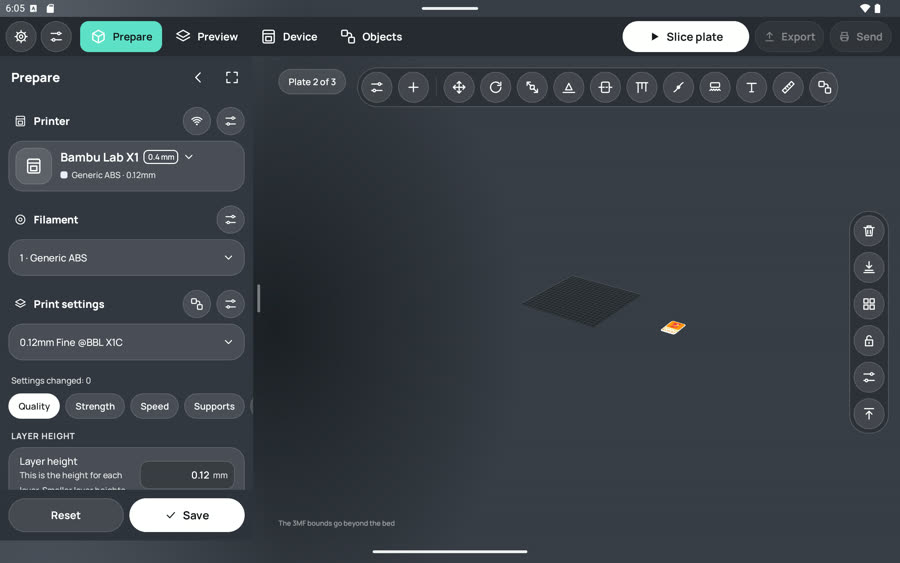 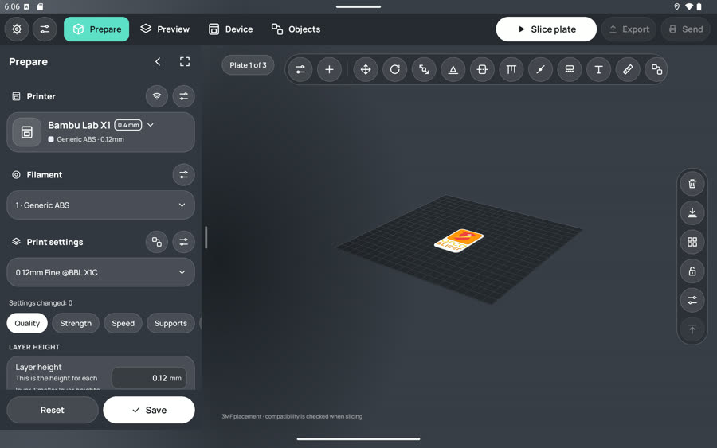 

## Round 3: owner videos 1–3 (2026-11-08, Pixel_Tablet emulator)

| # | Problem (video) | Root cause | Fix |
|---|---|---|---|
| 1 | Settings list jumped back to the top; "Loading profile settings" after returning from Preferences (1, 2) | Every workspace rebuild (return from any screen, bed or model update) created a new `ProcessSettingsPanel`, which reloaded the profile and started at the top | The editor outlives rebuilds: the same view is moved into the new layout; it reloads only when the printer/filament/process fingerprint changed (`reloadIfStale`); row rebuilds keep the scroll position, a new category starts at the top |
| 2 | Printer/Filament/Print settings took most of the panel (1, 3) | Mobile header card plus a separate title row and card per block | One-line selectors with the section caption (desktop combos); Objects is a collapsible block, collapsed by default |
| 3 | Category tabs cut ("Multi-mat") (1, 3) | No scroll to the selected chip | 44dp chips, the selected one is scrolled into view |
| 4 | Reset/Save always active (1) | No link to the change count | Enabled only when something differs from the saved profile |
| 5 | Mobile tab bar over Preferences rows (2) | `GlassNavigation` added by every screen | Hidden in tablet mode; Preferences uses a desktop two-pane layout (categories left, settings right, max width 760dp) |
| 6 | Previous screen showing through on transitions (2) | Fade-in over a held screen | Tablet mode switches screens without the overlay animation |
| 7 | Objects duplicated as a workspace tab and in the side strip; three panel states (3) | Mobile-style navigation | Workspaces: Prepare, Preview, Device; Objects lives in the Prepare panel; panel is expanded or hidden (no icon strip) |
| 8 | Tool bar cut off at the right (3) | Fixed set of buttons in a wrap-content bar | Tools that do not fit move to a "More tools" menu, recomputed when the panel width changes; tooltips for mouse |

Plate settings now include bed type and filament order (first / other layers) from the engine (`process_settings.cpp`,
category Plate). Checked: tab auto-scroll, scroll kept across Preferences, plate settings sheet, Preferences without the tab bar.

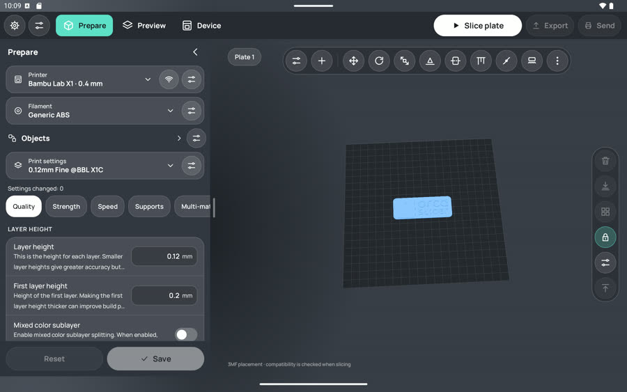 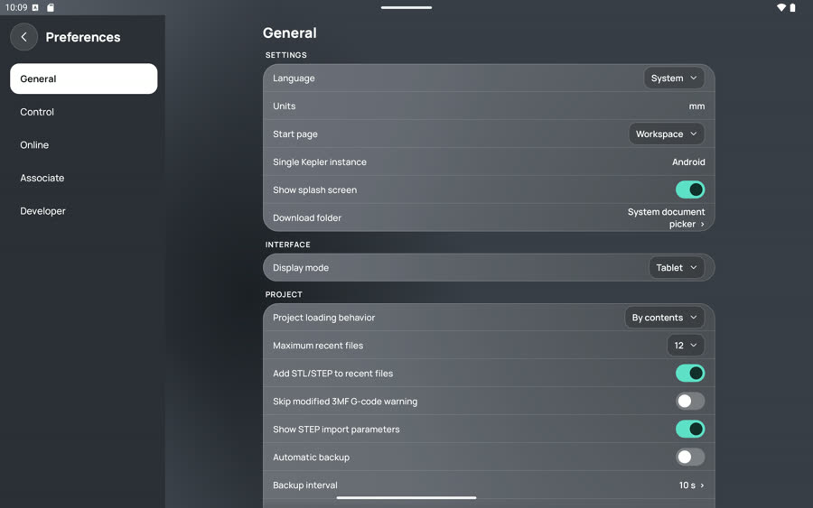
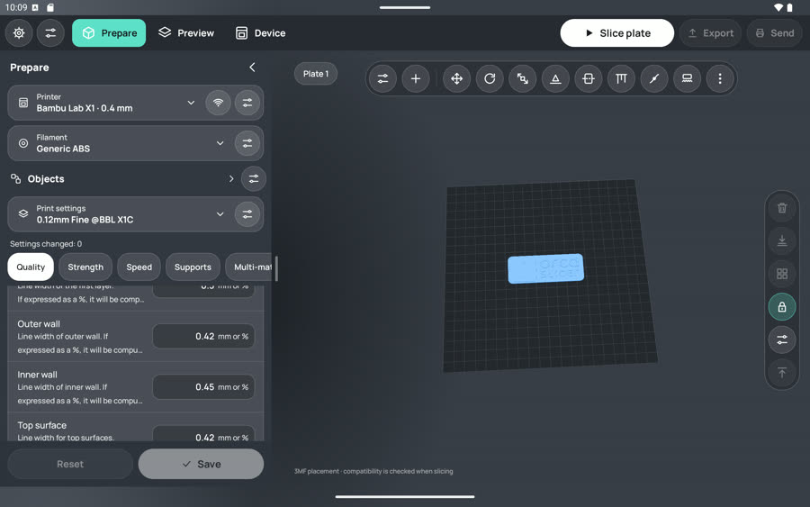 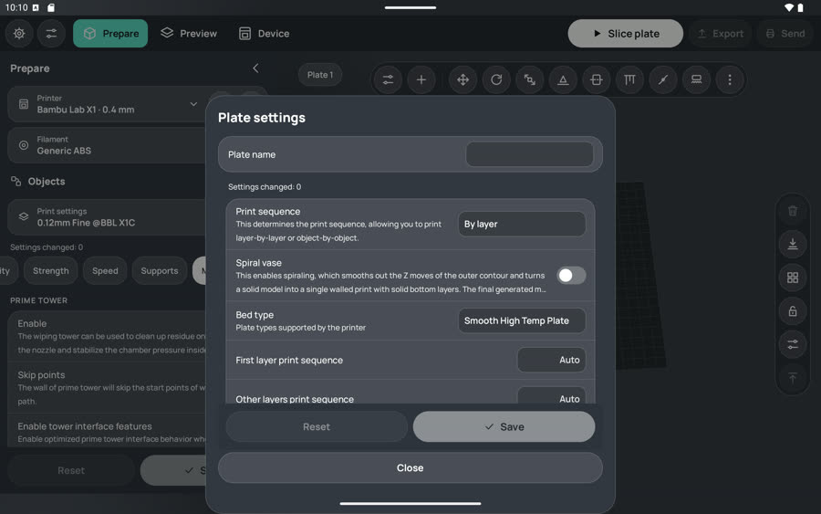

## Round 4: tablet = desktop OrcaSlicer, no mobile elements (2026-11-08)

| Problem (owner) | Cause | Fix |
|---|---|---|
| "Tools" sidebar with a tool grid duplicates the tool bar | tools reused the mobile tools sheet in the sidebar | tablet: no grid; the tool's values float on the plate under the bar (desktop gizmo panel, close ×); sidebar stays Prepare; active tool highlighted in the bar |
| "More tools" opens a bottom sheet | GlassBottomSheet | anchored drop-down menu (PopupWindow, 48 dp rows) |
| Dialogs see-through, full-width buttons, slide from the bottom | phone SheetDialog/AlertDialog styling | glass/Desktop.java: opaque compact window, centred, buttons on the right, fade; mobile unchanged |
| Slicing opens a separate "Slice model" screen | MainActivity started SliceActivity | SliceActivity.start(context) + Progress listener: progress strip on the plate, then Preview opens; auto-slice too |
| Preview: "slice again first" alert / "wait for the bed" alert | phone flow | Preview slices first, then waits for the plate silently |
| Preview panel duplicates Print/Export and the layer slider | phone preview sheet | tablet keeps legend and stats only; object tool bar hidden in Preview |
| Bambu printers failed to slice ("G92 E0") and showed no layers | headless engine never set is_BBL_printer; parser knew only ";LAYER_CHANGE" | engine sets it from printer_model; parser reads "; CHANGE_LAYER", "; FEATURE:"; time from the header |

Screenshots: tablet-audit/tablet-move-panel.jpg, tablet-slice-on-plate.jpg, tablet-preview-desktop.jpg,
tablet-dialog-desktop.jpg. Tests: core GcodeAnalysisTest (Bambu markers), host suites, control_stubs for inline
auto-slice. Not covered: DeviceActivity, full settings editor, pickers and export screens are still the mobile
screens; mouse/stylus input; other tablet sizes.

## Round 5: remaining screens as desktop windows and the Device workspace (2026-11-08)

| Screen | Before (mobile) | Now (tablet mode) |
|---|---|---|
| Printer / filament / process editor, profile pickers, connections, export, Preferences, model details, slice | full-screen phone screens with a back chevron and push animation | DesktopWindow: dialog window over the workspace (centred, dimmed, rounded opaque surface), × close, no animation; pickers in a narrower window |
| Device | phone column: camera, job, temperatures, AMS, controls stacked | Device workspace: same tab bar as Prepare/Preview, camera and job on the left, temperatures, AMS and controls on the right; tab opens it directly |
| Settings hub button in the top bar and the sidebar rail | duplicated the Prepare sidebar | removed; the hub stays only for 3MF project settings (window with ×) |
| Closing the printer editor | went back to the settings hub | closes the window |

Files: DesktopWindow.java (applied from KeplerApplication lifecycle callbacks), glass/Desktop.windowed,
KeplerUi.glassButton (back → × in windows), KeplerScreen (windowed tab roots get ×), DeviceActivity.desktopWorkspace,
SettingsActivity. Screenshots: tablet-audit/tablet-device-workspace.jpg, tablet-preferences-window.jpg,
tablet-printer-editor-window.jpg, tablet-printer-picker-window.jpg, tablet-export-window.jpg.
Not covered: mouse/stylus, other tablet sizes, live camera and real printer telemetry.
