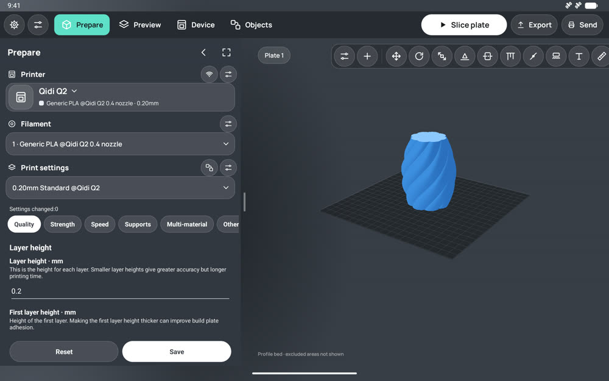
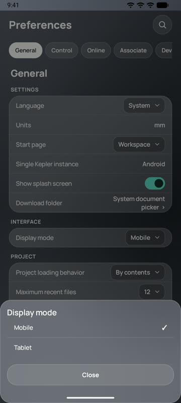
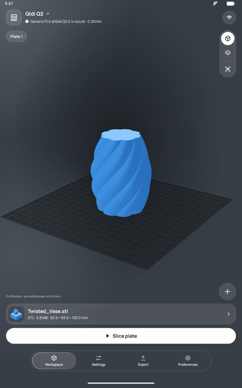
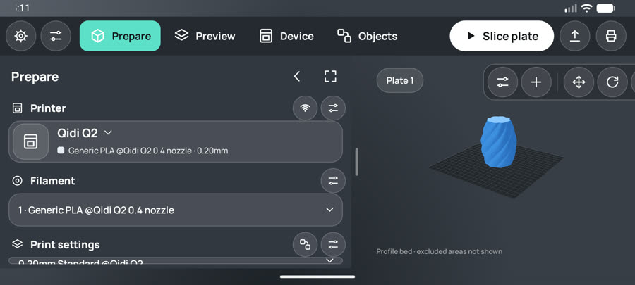
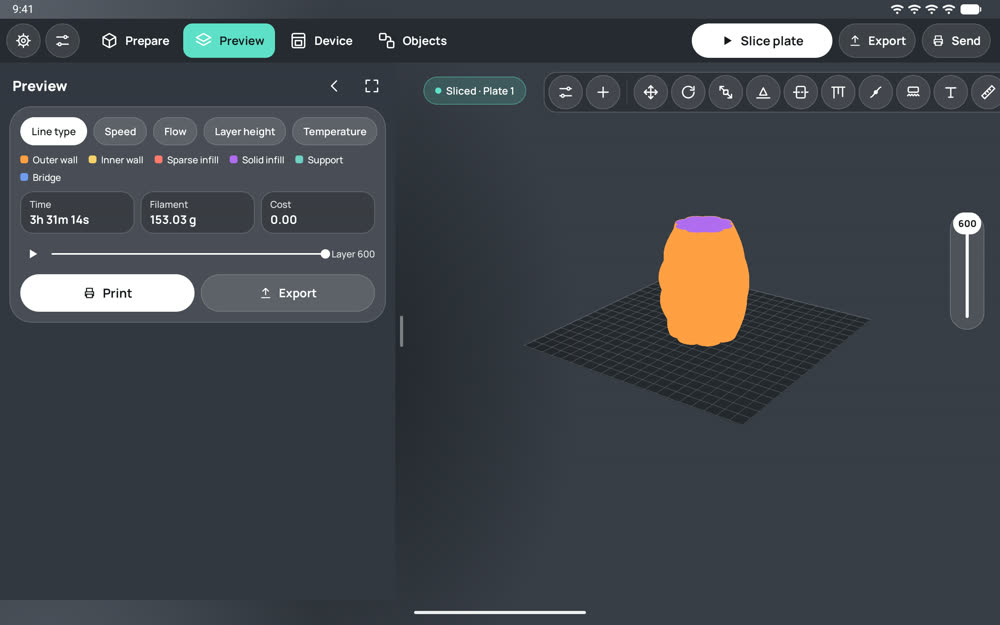
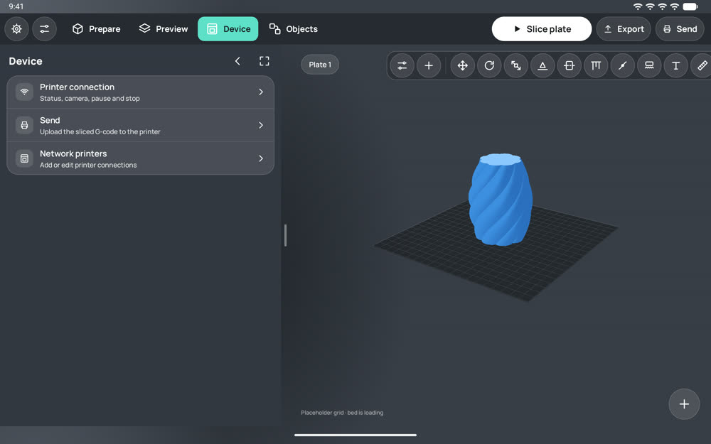
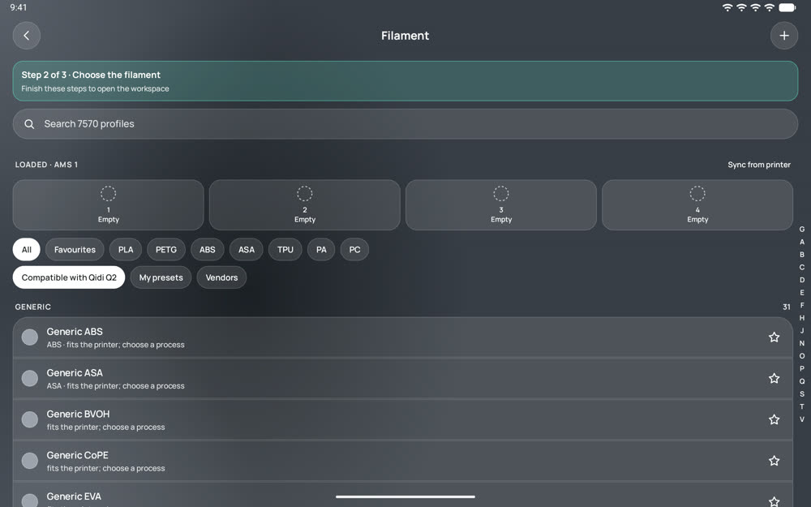
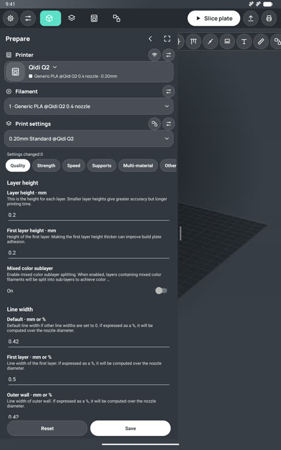
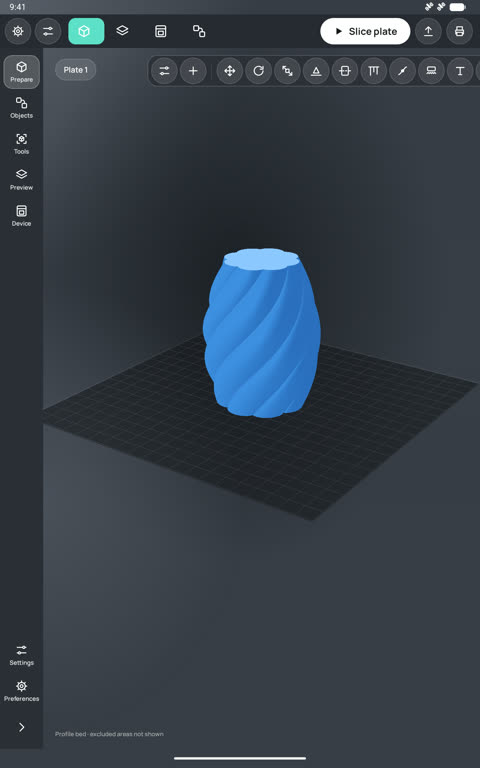
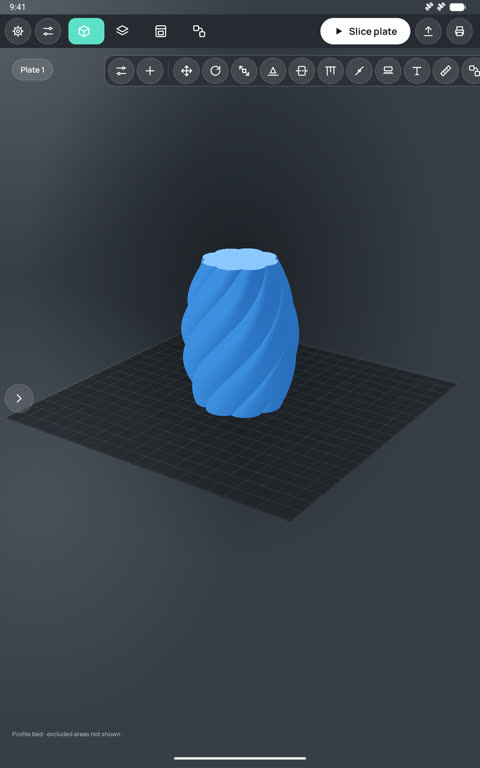

# Tablet workspace

Branch `feature/tablet-workspace`. An optional interface laid out like desktop OrcaSlicer: section tabs and the
Slice / Export / Send actions on top, printer, filament and print settings in a left panel, tools above the 3D plate.
The mobile interface stays the default and is unchanged.

## Choosing the interface

**Preferences → General → Interface → Display mode: Mobile / Tablet.** The value (`interface_mode`) is stored with the
other app preferences (`app_preferences`) and survives restarts. The app never picks the tablet mode by itself: the
screen size, density and orientation only adapt the layout the user chose. Both modes work on any device.

**Orientation is fixed by the mode:** the tablet interface runs in landscape only, the mobile interface in portrait
only (each either way up), on every screen of the app (`InterfaceMode.applyOrientation`, applied from
`KeplerApplication` to every activity and again as soon as the mode is changed).

Switching is applied when the workspace is shown again (`MainActivity.onResume` → `render()`): the model, project,
printer/filament/process selection, plate and camera are kept, because they live in the shared workspace state and
storage, not in the layout. Nothing is restarted, and the native engine is not reloaded.

| Preference | Mobile (portrait) |
|:---:|:---:|
|  |  |

Tablet mode on a phone (landscape):

## Layout

| Area | Contents |
|---|---|
| Top bar | Preferences, Settings, tabs **Prepare · Preview · Device · Objects**, then **Slice plate · Export · Send** |
| Left panel, Prepare | **Printer** (name, nozzle, material line; connection and printer settings icons), **Filament** (slot 1 and loaded slots), **Print settings** (process preset; the process editor with Quality / Strength / Speed / Supports / Multi-material / Others tabs, values edited in place, Reset / Save) |
| Left panel, Preview | Line type / speed / flow / layer height / temperature legend, time, filament, cost, layer slider, Print / Export |
| Left panel, Device | Printer connection, send, network printers |
| Left panel, Objects | Object list and per-object settings |
| Above the plate | Panel toggle, add model, move, rotate, scale, lay on face, cut, support / seam / fuzzy-skin paint, text, measure, assembly, brim ears |
| 3D area | The same `StlView` as the mobile layout; plate chip, layer rail, gizmos |

| Preview | Device | Printer change → step 2 |
|:---:|:---:|:---:|
|  |  |  |

## Panel states

| State | Behaviour |
|---|---|
| Expanded | Section content; width set by dragging the right edge (280–560 dp, limited by the window), saved in `tablet_sidebar_width_dp` |
| Collapsed | 72 dp icon strip: five sections, Settings, Preferences, expand |
| Hidden | The plate takes the full width; a 48 dp button at the left edge brings the panel back |

State, width and section are saved (`tablet_sidebar_state`, `tablet_sidebar_width_dp`, `tablet_sidebar_section`).
Changing them moves the 3D view with a margin; the GL surface is resized, never recreated. The resize handle takes
its own touches, so dragging it never rotates the camera.

| Expanded (before the landscape-only rule) | Collapsed | Hidden |
|:---:|:---:|:---:|
|  |  |  |

## Adaptation rules (`core/TabletLayout`, JUnit `TabletLayoutTest`)

- The window width comes from `WindowManager.getCurrentWindowMetrics()`, so split screen and freeform windows count.
- If an expanded panel would leave less than 360 dp of 3D area, it floats over the scene instead of docking.
- Below 900 dp the tabs show icons only; below 1100 dp Export and Send are icon buttons; below 600 dp Slice too.
- The panel width is clamped to the window on every layout.
- Windows under 700 dp high (phones): the whole Prepare column scrolls and the settings editor gets a screen of height.

## Keyboard

Ctrl+O add model · Ctrl+Enter slice · Ctrl+B collapse/expand the panel · Ctrl+\ hide/show it · Ctrl+1…5 sections.
The mouse wheel zooms the 3D view (existing behaviour).

## Changed components

| File | Change |
|---|---|
| `core/.../TabletLayout.java`, `core/src/test/.../TabletLayoutTest.java` | Panel states, width limits, docking/overlay rules |
| `app/.../InterfaceMode.java` | Stored interface preferences |
| `app/.../TabletSidebar.java` | Left panel: strip, header, fixed Prepare column, scrolling sections, resize handle |
| `app/.../MainActivity.java` | Tablet top bar, canvas toolbar, Prepare / Objects / Device blocks, embedded process editor, section sync with workspace modes, keyboard shortcuts |
| `app/.../PreferencesActivity.java` | Interface → Display mode |
| `app/.../glass/KeplerUi.java` | Mode bar change listener |
| `app/.../KeplerScreen.java` | Scrolling content ends above the floating tab bar (the last button sat under it in landscape) |
| `app/.../ProcessSettingsPanel.java` | Setting names are translated only in the Russian interface |
| `app/.../ImportActivity.java`, `GeneralPreferences.java` | `application/vnd.ms-pki.stl` accepted: STL files were greyed out in the system picker |
| `app/.../PrinterPickerActivity.java` | Setup banner below the title; keyboard closed on the model details |

## Defects found and fixed

| Defect | Fix |
|---|---|
| STL files could not be picked (greyed out) | Added the MIME type the system reports for `.stl` |
| Saving the printer was hidden under the floating tab bar in landscape | Scrolling content and lists keep clearance above the tab bar |
| The workspace froze for ~4 s on start in tablet mode (ANR) | The "last result" check read the G-code file on the main thread; it runs on a worker now |
| Settings names in Russian in an English interface | Translation table applied only to Russian |
| Search keyboard stayed open over the printer details | Closed when the details open |
| Phone width: Slice covered the tabs | Icon-only buttons on narrow windows |
| Phone landscape: settings editor squeezed to zero height | Prepare column scrolls on short windows |
| Scrolled glass cards drew over the panel header | Panel content clipped to its outline |

## Results

- `./gradlew assembleDebug` — OK. `./gradlew :core:test` (incl. `TabletLayoutTest`) — OK. `tools/run_host_tests.ps1` — all passed.
- Checked on the emulator by screenshots: 10" tablet (1600×2560, 320 dpi) portrait and landscape, phone 1080×2400;
  expanded, collapsed, hidden; resize and restart (width 506 dp restored); switching mobile ↔ tablet with a loaded model;
  printer change in tablet mode (filament and process steps, back to the same workspace); slicing and layer preview.

## Limitations and open items

- Settings, filament/process pickers, slicing, export and the device screen still open as their own screens (as in
  mobile mode); only the process editor is embedded in the panel.
- Objects shows the object list; per-object settings open the existing model details screen. No object tree yet.
- Undo/redo is not implemented in the app, so it is not offered in either mode.
- Right-click context menu and stylus-specific input are not implemented.
- Portrait shots of the panel states above were taken before the landscape-only rule.
- The emulator lost its graphics twice after `adb reboot` (white screens, System UI not responding); a cold boot fixed it. These were emulator faults, not app crashes.
- Not run: 7–8" and 12–14" tablets, foldables, split screen, freeform/desktop windows, large system fonts in tablet
  mode, process death while the panel is open, a real printer connection.
- Start-up is heavy (~60–100 skipped frames) in both modes and needs separate profiling.
