# UI/UX audit — round 1 (2026-11-07)

Branch `ui-ux-audit`. Checked on the Android emulator (Pixel, 1080×2400, 420 dpi, Android 16) by screenshots and
screen recordings after every change. Not every screen of the app was covered in this round; see
[Not covered yet](#not-covered-yet).

## Summary

| # | Problem | Priority | Status |
|---|---|---|---|
| 1 | Input sheets fly in from the side and jump when the keyboard opens (every editor in the app) | Critical | Fixed |
| 2 | Printer can be chosen without a filament and layer height; the workspace opens half configured | Critical | Fixed |
| 3 | Search does not always open and loses typed text (printer, filament/process, settings) | Critical | Fixed |
| 4 | Search finds only an exact substring ("bambu x1" finds nothing) | High | Fixed |
| 5 | Tab bar over lists is 77% transparent; scrolled text shows through its labels | High | Fixed |
| 6 | Nozzle badge in the workspace header is cut to "0.4…" at large font sizes | Medium | Fixed |
| 7 | Glass buttons (44 dp), chips (36 dp), mode bar and the material row are below 48 dp | Medium | Fixed (touch area) |
| 8 | Landscape: the tab bar spans the width and takes height from the 3D view | Medium | Fixed |
| 9 | Layer height is not visible on the workspace | Low | Fixed |
| 10 | CI: all runs fail | High | Cause outside the code (billing); triggers reduced |
| 11 | `engine/build-native.ps1` reads JNI classes from the old path `app/src/main/java/...` | High | Fixed |

## 1. Input sheets jump and fly in from the side

**Reproduce (before):** Settings → printer → Machine G-code → tap Start G-code. The sheet appears narrow on the
right, moves up, then down (owner video, 2026-11-07).

**Cause:** nine copies of the same code showed a floating `Dialog` with the default dialog theme (wrap width,
centred) and only after `show()` stretched it to full width with `setLayout`; `SettingsEditorDialog.AdaptiveHeight`
then moved the window (`attributes.y`) and changed its height on every layout and keyboard change.

**Fix:** one component, [`glass/SheetDialog.java`](../app/src/main/java/com/keplerslicer/app/glass/SheetDialog.java).
The window is full screen and edge-to-edge from the first frame and never changes; the sheet is a view pinned to
the bottom, the keyboard is followed frame by frame (`WindowInsetsAnimation`), the card runs under the gesture bar,
landscape and tablets get a centred sheet up to 640 dp. All nine call sites use it
(`SettingsEditorDialog`, `GlassBottomSheet`, `MainActivity`, `PreferencesActivity` ×2, `ProjectMaterialEditor`,
`SettingsActivity` ×2, `StepImportPreferences`); `AdaptiveHeight` was removed.

| Before (owner video) | After | After, keyboard open |
|:---:|:---:|:---:|
| 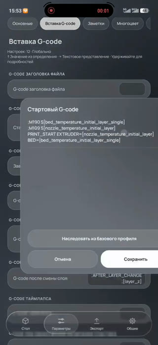 | 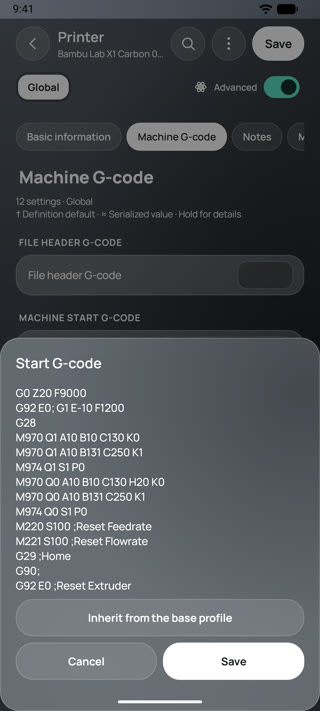 | 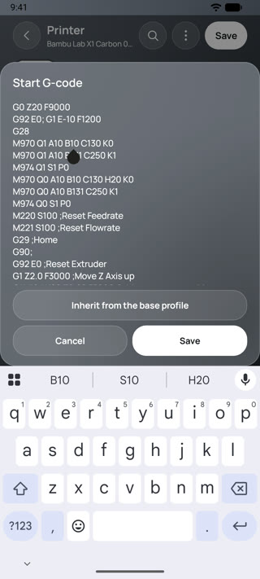 |

## 2. Mandatory printer → filament → layer height

**Before:** first launch showed "Choose printer" on an empty workspace; choosing a printer closed the picker and
returned to the workspace without a filament or process.

**Fix:** [`SetupFlow.java`](../app/src/main/java/com/keplerslicer/app/SetupFlow.java). Step 1 printer and nozzle,
step 2 filament, step 3 layer height (process profile). The workspace opens only after all three; changing the
printer or nozzle asks for filament and process again. Back returns to the previous step; Back on the first step
leaves the app instead of skipping the setup; the tab bar is hidden during setup, so it cannot be bypassed. An
unfinished setup resumes after a restart. User (imported) printer profiles skip steps 2–3, as the catalog pickers do
not apply to them.

| Before | Step 1 | Step 2 | Step 3 | Workspace |
|:---:|:---:|:---:|:---:|:---:|
| 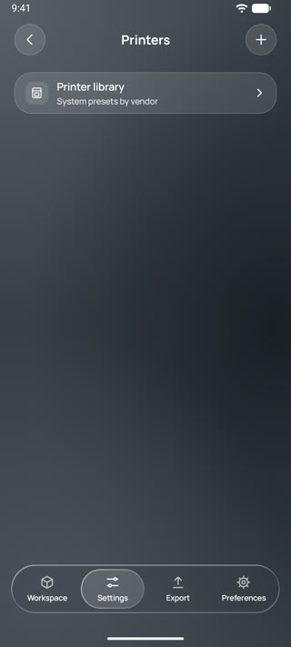 | 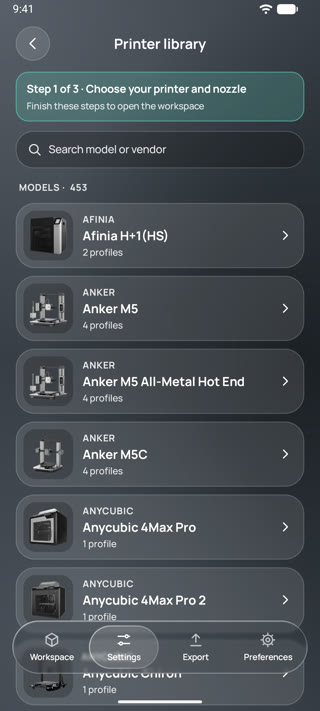 | 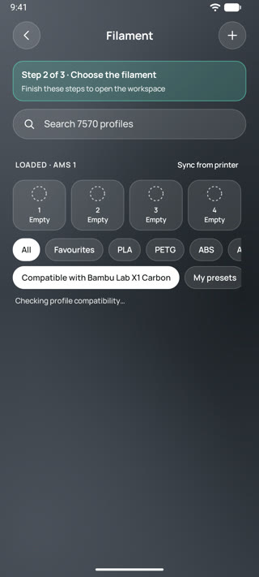 | 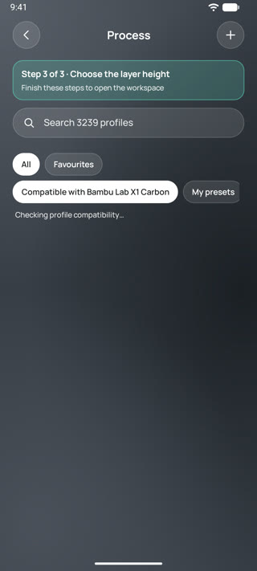 | 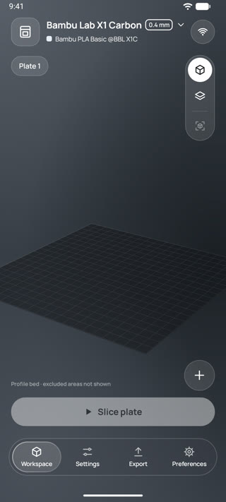 |

## 3–4. Search

**Cause:** the search fields of the printer library, the filament/process picker and the settings editor were
inside a `ListView` header. Every refilter rebuilt the list and took focus from the field (keyboard closed, typing
lost); in the settings editor the toggle could open the field off screen when the list was scrolled.

**Fix:** the fields are pinned above the lists
([`PrinterPickerActivity`](../app/src/main/java/com/keplerslicer/app/PrinterPickerActivity.java),
[`ProfilePickerActivity`](../app/src/main/java/com/keplerslicer/app/ProfilePickerActivity.java),
[`SettingsActivity`](../app/src/main/java/com/keplerslicer/app/SettingsActivity.java)). Matching is by words in any
order, case-insensitive, `ё`=`е`, `_`/`-` as spaces:
[`core/SearchMatch.java`](../core/src/main/java/com/keplerslicer/app/SearchMatch.java), JUnit
[`SearchMatchTest`](../core/src/test/java/com/keplerslicer/app/SearchMatchTest.java).

| Before: "bambu x1" | After |
|:---:|:---:|
| 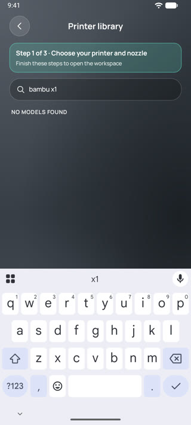 | 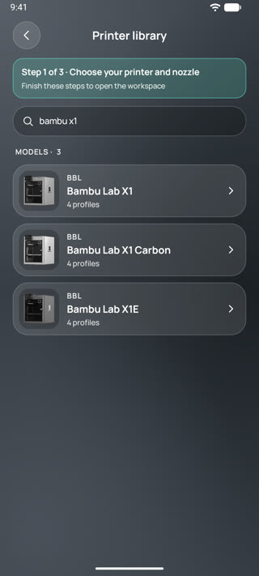 |

## 5–9. Readability, touch areas, landscape

- **Selective transparency** ([`GlassNavigation`](../app/src/main/java/com/keplerslicer/app/glass/GlassNavigation.java)):
  the tab bar stays clear glass only over the 3D plate; over lists it is 85% opaque with a 16 dp blur.
- **Nozzle badge** ([`KeplerUi.header`](../app/src/main/java/com/keplerslicer/app/glass/KeplerUi.java)): the
  printer name gives way to the badge; the badge is never ellipsized. Layer height is shown after the filament.
- **48 dp** ([`glass/TouchTarget.java`](../app/src/main/java/com/keplerslicer/app/glass/TouchTarget.java)): small
  controls keep their look but get a 48 dp touch area, also above the 3D view (which used to take those touches).
  Checked: a tap 4 px below the 44 dp Wi-Fi button opens the connection screen.
- **Landscape** ([`MainActivity.workspace`](../app/src/main/java/com/keplerslicer/app/MainActivity.java)): the tab
  bar moved into the side column; the 3D view gets the full height.

| Header at 130% font, before | After |
|:---:|:---:|
| 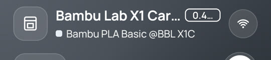 | 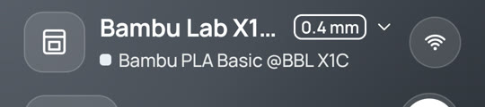 |

| Landscape before | Landscape after |
|:---:|:---:|
| 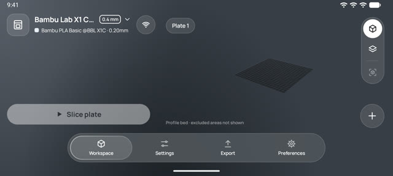 | 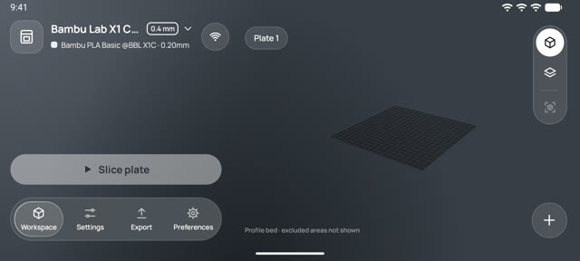 |

## 10–11. CI and the native build script

- All 8 recent CI runs failed before starting: GitHub reports *"The job was not started because your account is
  locked due to a billing issue"*. This is fixed in the GitHub account billing settings, not in the code. The
  workflow now runs only for `master` and pull requests, skips documentation-only changes and cancels superseded
  runs, to use fewer Actions minutes.
- [`engine/build-native.ps1`](../engine/build-native.ps1) now reads the JNI declarations from `engine/java/...`.

## Test results

| Check | Result |
|---|---|
| `./gradlew assembleDebug` | OK |
| `./gradlew :core:test` (JUnit, incl. `SearchMatchTest`) | OK |
| `tools/run_host_tests.ps1` (17 suites) | All passed |
| Emulator, portrait 100% and 130% font, landscape, keyboard | Checked by screenshots and recordings (above) |

## Not covered yet

- Screens not reviewed in this round: Export, Device/printer control, Network, Import details, G-code preview,
  tools (move/rotate/scale, paint brushes), multi-plate projects, STEP import options.
- Tablets and compact phones were not run; the sheet width cap is meant for them but is unverified there.
- No instrumentation, screenshot-regression or Maestro tests yet (the Maestro and adb MCP servers did not connect in
  this session); checks were done by hand with adb.
- The app has only a dark theme; a light system theme was not tested.
- In landscape the camera keeps the zoom saved in portrait; the fit button is disabled on an empty plate.
- The status-bar strip above an open sheet is not dimmed.
